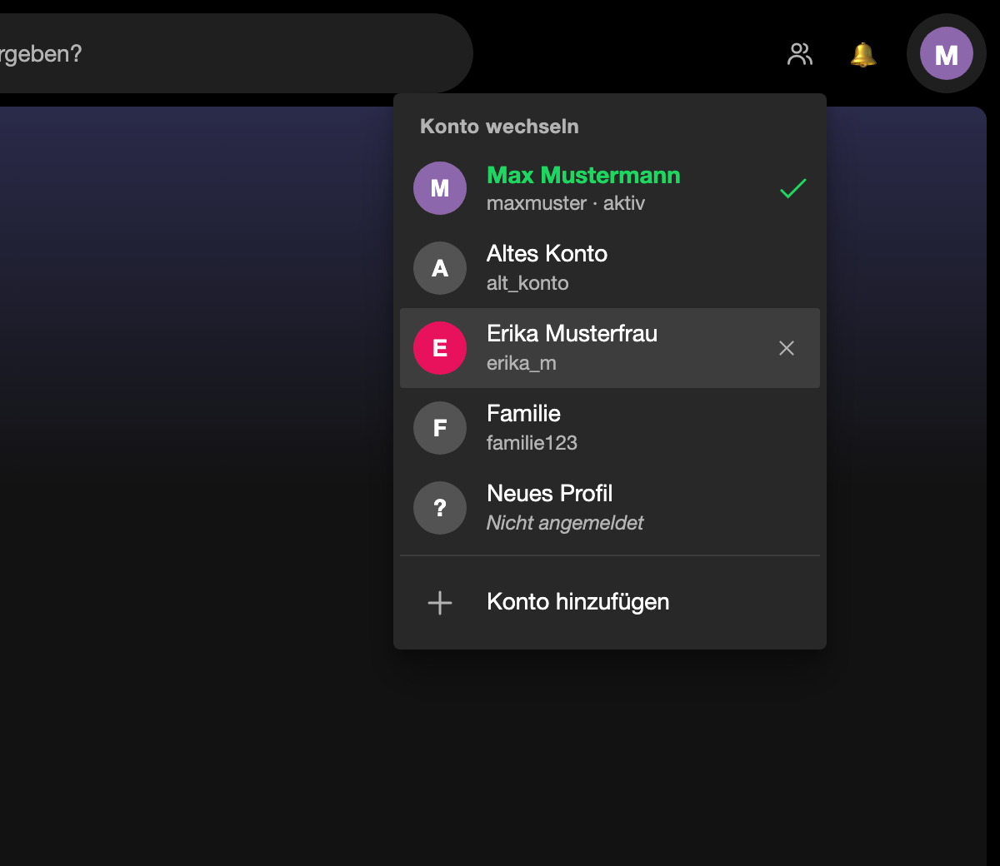

# Spicetify Account Switcher

A simple multi-account switcher button for the Spotify desktop app on **macOS** – built as a
[Spicetify](https://spicetify.app) extension plus a tiny on-demand helper.



- **Switcher button** in Spotify's top bar, next to your avatar.
- **Account list** with avatar, name and a check mark on the active account.
- **„Konto hinzufügen“ (add account)** at the bottom: a new Spotify window opens with the login
  screen, and your browser opens Spotify's **password login** (email + password, no email code).
- **Fast switch, no re-login:** every account keeps its own Spotify profile and stays logged in.
  Switching starts the other profile at the same window position (ready in ~2 s) and then closes
  the old one – the window never goes blank, and only one Spotify runs in memory.
- **Remove** an account from the list (its profile folder is moved to the Trash, never deleted).

The UI is in German.

## How it works

Spotify can run with `--mu=<id>`, which gives each instance its own data folder
(`~/Library/Application Support/Spotify-<id>`) including its own saved login. The extension
cannot start another Spotify by itself, so a small Python helper (standard library only) does it.
It is **socket-activated by launchd**: nothing runs in the background – macOS starts the helper on
the first click and it exits again after 60 s idle. It only listens on `127.0.0.1:48655` and only
accepts requests from Spotify's UI.

The helper never reads or copies Spotify login data. Details: [docs/ARCHITECTURE.md](docs/ARCHITECTURE.md).

## Installation

Requirements: macOS, Spotify desktop app in `/Applications`, [Spicetify](https://spicetify.app/docs/getting-started).

```bash
git clone https://github.com/JustNotesa/spicetify-account-switcher.git
cd spicetify-account-switcher
./install.sh --apply
```

`--apply` runs `spicetify apply` (Spotify restarts once).

**Installed the extension from the Spicetify Marketplace?** You still need the helper once:

```bash
./install.sh --helper-only
```

### First use

1. Your current Spotify account shows up as the first profile.
2. Click **Konto hinzufügen**, log in with the other account in the new window / browser.
3. From now on switch with one click.

## Uninstall

```bash
./uninstall.sh            # removes helper, LaunchAgent and extension, keeps your profiles
./uninstall.sh --purge    # also removes the helper's own data (profile list, logs)
```

Spotify profile folders (`Spotify-<id>`) are never touched by the uninstaller.

## Tests

```bash
cd helper && python3 -m unittest -v test_helper    # helper (fake profiles, nothing is started)
node extension/test/run-tests.js                     # extension, headless Chromium (needs Playwright)
```

## Deutsch (kurz)

Ein Knopf oben in Spotify zum Kontowechsel. Jedes Konto hat ein eigenes Spotify-Profil und bleibt
angemeldet. Ein Klick startet das andere Profil an derselben Stelle und schließt danach das alte.
„Konto hinzufügen“ öffnet ein neues Spotify-Fenster und im Browser die Passwort-Anmeldung.
Installation: `./install.sh --apply`.

## License

MIT
